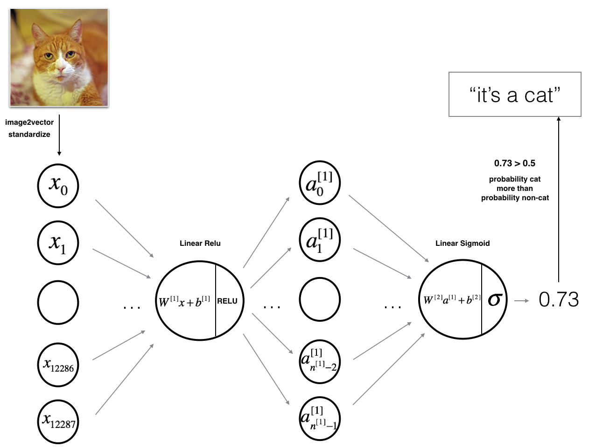
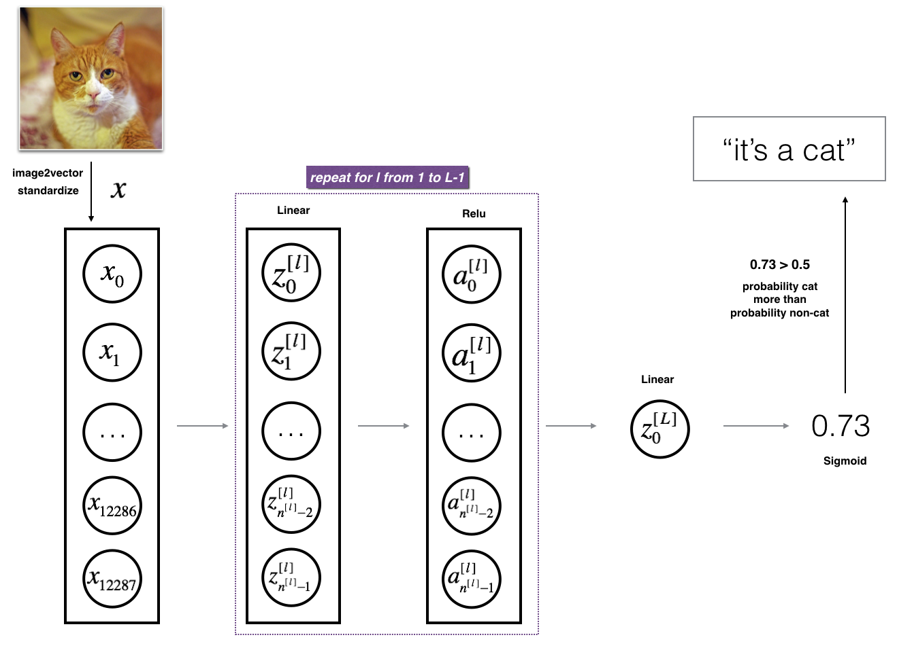

# Deep Neural Network for Image Classification (Cat vs. Non-Cat)

[](https://www.python.org/)
[](https://numpy.org/)
[](https://jupyter.org/)
[](https://www.coursera.org/specializations/deep-learning)
[](LICENSE)

An end-to-end implementation of deep feedforward neural networks built from scratch in pure **NumPy** to solve binary image classification (*Cat* vs. *Non-Cat*). This project explores and benchmarks both a **2-layer neural network** and an arbitrary-depth **L-layer deep neural network (4 layers)**, highlighting how hierarchical feature representation improves generalization accuracy on computer vision tasks.

Part of **Course 1: Neural Networks and Deep Learning (Week 4)** of the [Deep Learning Specialization](https://www.coursera.org/specializations/deep-learning) by **Andrew Ng (DeepLearning.AI)**.

---

## Table of Contents

- [Overview](#overview)
- [Key Features](#key-features)
- [Dataset Preprocessing](#dataset-preprocessing)
- [Model Architectures](#model-architectures)
  - [1. Two-Layer Neural Network](#1-two-layer-neural-network)
  - [2. Deep L-Layer Neural Network (4 Layers)](#2-deep-l-layer-neural-network-4-layers)
- [Mathematical Formulation](#mathematical-formulation)
  - [Forward Propagation](#forward-propagation)
  - [Loss & Cost Function](#loss--cost-function)
  - [Backward Propagation](#backward-propagation)
  - [Parameter Updates](#parameter-updates)
- [Experimental Results](#experimental-results)
- [Error Analysis](#error-analysis)
- [Repository Structure](#repository-structure)
- [Installation & Quickstart](#installation--quickstart)
  - [1. Clone Repository](#1-clone-repository)
  - [2. Set Up Virtual Environment](#2-set-up-virtual-environment)
  - [3. Install Dependencies](#3-install-dependencies)
  - [4. Running the Standalone Script](#4-running-the-standalone-script)
  - [5. Running the Jupyter Notebook](#5-running-the-jupyter-notebook)
- [Verification & Tests](#verification--tests)
- [References & Acknowledgments](#references--acknowledgments)

---

## Overview

In binary image classification, a model determines whether an input RGB image contains a cat ($y = 1$) or not ($y = 0$). While single-layer models (logistic regression) and shallow 2-layer networks capture low-level image edges, **deeper architectures** learn hierarchical representations—from basic edges in early layers, to textures and object parts in intermediate layers, up to recognizable feline features in deeper layers.

This repository implements:
1. **2-Layer Neural Network**: `LINEAR -> RELU -> LINEAR -> SIGMOID`
2. **L-Layer Deep Neural Network**: `[LINEAR -> RELU]*(L-1) -> LINEAR -> SIGMOID` (configured as a 4-layer network)

All vectorization, forward activation, cross-entropy cost evaluation, backward gradient computation, and gradient descent optimization are coded with pure matrix mathematics in NumPy without high-level deep learning frameworks.

---

## Key Features

- **Built Completely from Scratch**: No TensorFlow or PyTorch—mastering gradient calculus, matrix calculus, and memory-efficient cache caching.
- **Modular Architecture**: Separate utility components for initialization, activation functions, linear/activation forward passes, backward passes, and parameter updates.
- **Rigorous Validation**: Integrated unit tests checking matrix shapes, datatypes, and numerical precision against precomputed Coursera benchmark tensors.
- **Dual Interface**: Run either interactively via `Deep Neural Network - Application.ipynb` or via the CLI training engine `train.py`.
- **Inference & Custom Images**: Built-in support to predict cat probabilities on unseen personal images with real-time resizing and preprocessing.

---

## Dataset Preprocessing

The dataset is stored in HDF5 format (`.h5`) and contains 64x64 pixel RGB images labeled as cat ($1$) or non-cat ($0$):

| Dataset Split | Number of Examples | Feature Dimensions (Raw) | Vectorized Dimensions ($X$) |
|:--------------|:------------------:|:------------------------:|:---------------------------:|
| **Training**  | 209                | $(209, 64, 64, 3)$       | $(12288, 209)$              |
| **Test**      | 50                 | $(50, 64, 64, 3)$        | $(12288, 50)$               |

### Preprocessing Pipeline:
1. **Unroll / Flatten**: Each image of shape $(64, 64, 3)$ is flattened into a single feature column vector of dimension $n_x = 64 \times 64 \times 3 = 12288$.
2. **Feature Normalization**: Pixel channel intensities $[0, 255]$ are standardized to float values in $[0.0, 1.0]$:
   ```python
   train_x = train_x_flatten / 255.0
   test_x = test_x_flatten / 255.0
   ```

---

## Model Architectures

### 1. Two-Layer Neural Network

A shallow network with one hidden ReLU layer and one output Sigmoid layer:



- **Input Layer**: $n_x = 12288$ features
- **Hidden Layer 1**: $n_h = 7$ neurons with $\text{ReLU}$ activation
- **Output Layer**: $n_y = 1$ neuron with $\text{Sigmoid}$ activation

```
INPUT (12288) ---> [ LINEAR -> RELU (7) ] ---> [ LINEAR -> SIGMOID (1) ] ---> OUTPUT (Probability)
```

### 2. Deep L-Layer Neural Network (4 Layers)

A deep network with 4 layers (3 hidden ReLU layers and 1 output Sigmoid layer):



- **Layer Dimensions**: `[12288, 20, 7, 5, 1]`
- **Layer 1**: 20 hidden units ($\text{ReLU}$)
- **Layer 2**: 7 hidden units ($\text{ReLU}$)
- **Layer 3**: 5 hidden units ($\text{ReLU}$)
- **Layer 4**: 1 output unit ($\text{Sigmoid}$)

```
INPUT (12288) ---> [LINEAR -> RELU (20)] ---> [LINEAR -> RELU (7)] ---> [LINEAR -> RELU (5)] ---> [LINEAR -> SIGMOID (1)] ---> OUTPUT
```

---

## Mathematical Formulation

### Forward Propagation

For each layer $l \in [1, L]$:

$$\mathbf{Z}^{[l]} = \mathbf{W}^{[l]} \mathbf{A}^{[l-1]} + \mathbf{b}^{[l]}$$

$$\mathbf{A}^{[l]} = g^{[l]}(\mathbf{Z}^{[l]})$$

where:
- $\mathbf{A}^{[0]} = \mathbf{X}$ is the input feature matrix.
- For hidden layers $l \in [1, L-1]$, activation function $g^{[l]}(z) = \max(0, z)$ ($\text{ReLU}$).
- For the final output layer $L$, activation function $g^{[L]}(z) = \sigma(z) = \frac{1}{1 + e^{-z}}$ ($\text{Sigmoid}$).

### Loss & Cost Function

The objective is to minimize the binary cross-entropy cost over all $m$ examples:

$$\mathcal{J}(\mathbf{W}, \mathbf{b}) = -\frac{1}{m} \sum_{i=1}^m \left[ y^{(i)} \log(a^{[L](i)}) + (1 - y^{(i)}) \log(1 - a^{[L](i)}) \right]$$

### Backward Propagation

Gradients are computed using the multivariate chain rule across backward passes:

1. **Output layer derivative**:
   $$d\mathbf{A}^{[L]} = -\left( \frac{\mathbf{Y}}{\mathbf{A}^{[L]}} - \frac{1 - \mathbf{Y}}{1 - \mathbf{A}^{[L]}} \right)$$

2. **Linear & Activation backward pass for layer $l$**:
   $$d\mathbf{Z}^{[l]} = d\mathbf{A}^{[l]} * {g^{[l]}}'(\mathbf{Z}^{[l]})$$
   $$d\mathbf{W}^{[l]} = \frac{1}{m} d\mathbf{Z}^{[l]} (\mathbf{A}^{[l-1]})^T$$
   $$d\mathbf{b}^{[l]} = \frac{1}{m} \sum_{i=1}^m d\mathbf{Z}^{[l](i)}$$
   $$d\mathbf{A}^{[l-1]} = (\mathbf{W}^{[l]})^T d\mathbf{Z}^{[l]}$$

### Parameter Updates

Parameters are updated using standard gradient descent with learning rate $\alpha$:

$$\mathbf{W}^{[l]} := \mathbf{W}^{[l]} - \alpha \cdot d\mathbf{W}^{[l]}$$

$$\mathbf{b}^{[l]} := \mathbf{b}^{[l]} - \alpha \cdot d\mathbf{b}^{[l]}$$

---

## Experimental Results

Both models were trained for $2,500$ iterations using a learning rate $\alpha = 0.0075$:

| Architecture | Layer Configuration | Initial Cost | Final Cost (2500 iters) | Training Accuracy | Test Accuracy | Generalization Gain |
|:---|:---:|:---:|:---:|:---:|:---:|:---:|
| **2-Layer NN** | `[12288, 7, 1]` | $0.6930$ | $0.0442$ | **100.0%** | **72.0%** | Baseline |
| **4-Layer Deep NN** | `[12288, 20, 7, 5, 1]` | $0.7717$ | $0.0884$ | **98.6%** | **80.0%** | **+8.0% Accuracy** |

### Key Observations:
- **Overfitting in the Shallow Network**: The 2-layer network achieves 100% training accuracy but plateaus at 72% test accuracy, showing signs of overfitting to training instances.
- **Superior Representation in Deep Network**: The 4-layer network achieves an **80% accuracy** on the unseen test set (+8% absolute improvement), confirming that stacking non-linear representations helps generalize to complex natural image distributions.

---

## Error Analysis

Evaluating the 4-layer model on the test set identifies a few misclassified samples. Common failure modes include:
1. **Unusual Positions / Poses**: Cats curled in unfamiliar configurations or upside-down.
2. **Color Camouflage**: Cats with fur color closely blending into the surrounding background (e.g., green rug or brown furniture).
3. **Occlusion & Lighting**: Highly shadowed environments or zoomed-in views showing only partial facial textures.

---

## Repository Structure

```
Deep-Neural-Network-Application/
│
├── datasets/
│   ├── train_catvnoncat.h5         # Training dataset (209 labeled images)
│   └── test_catvnoncat.h5          # Test dataset (50 labeled images)
│
├── images/
│   ├── 2layerNN_kiank.png          # 2-layer network architecture diagram
│   ├── LlayerNN_kiank.png          # L-layer deep network architecture diagram
│   ├── imvector.png                # Vectorization schematic
│   ├── imvectorkiank.png           # Feature flattening visualization
│   └── my_image.jpg                # Sample custom test image
│
├── Deep Neural Network - Application.ipynb   # Solved, fully executed Jupyter Notebook
├── train.py                        # Standalone CLI training and comparison script
├── dnn_app_utils_v3.py             # Utility functions (forward/backprop, activations, load_data)
├── test_utils.py                   # Automated assertion and comparison testing framework
├── public_tests.py                 # Coursera public unit tests for graded functions
├── requirements.txt                # Python package dependencies
├── .gitignore                      # Git ignore file for Python, Jupyter & OS artifacts
└── README.md                       # Comprehensive professional documentation
```

---

## Installation & Quickstart

### 1. Clone Repository

```bash
git clone https://github.com/Ubaidashraf5/Deep-Neural-Network-Application.git
cd Deep-Neural-Network-Application
```

### 2. Set Up Virtual Environment

```bash
# Windows
python -m venv venv
.\venv\Scripts\activate

# macOS / Linux
python3 -m venv venv
source venv/bin/activate
```

### 3. Install Dependencies

```bash
pip install -r requirements.txt
```

### 4. Running the Standalone Script

To train both the 2-layer and 4-layer models from the command line:

```bash
python train.py --iterations 2500 --lr 0.0075
```

Optional arguments:
- `--iterations`: Number of gradient descent iterations (default: `2500`)
- `--lr`: Learning rate (default: `0.0075`)
- `--save_plot`: Save learning curve comparison to `images/cost_comparison.png`

### 5. Running the Jupyter Notebook

Launch the notebook environment to step through the code and visualizations interactively:

```bash
jupyter notebook "Deep Neural Network - Application.ipynb"
```

---

## Verification & Tests

To execute the unit tests independently and verify the mathematical correctness of `two_layer_model` and `L_layer_model`:

```bash
python -c "from dnn_app_utils_v3 import *; from public_tests import *; from train import two_layer_model, L_layer_model; two_layer_model_test(two_layer_model); L_layer_model_test(L_layer_model)"
```

Expected output:
```
 All tests passed.
 All tests passed.
```

---

## References & Acknowledgments

- **Course**: [Deep Learning Specialization on Coursera](https://www.coursera.org/specializations/deep-learning)
- **Instructor**: [Andrew Ng](https://www.andrewng.org/), DeepLearning.AI
- **License**: This project is licensed under the MIT License - feel free to use and adapt it for learning and portfolio purposes.
